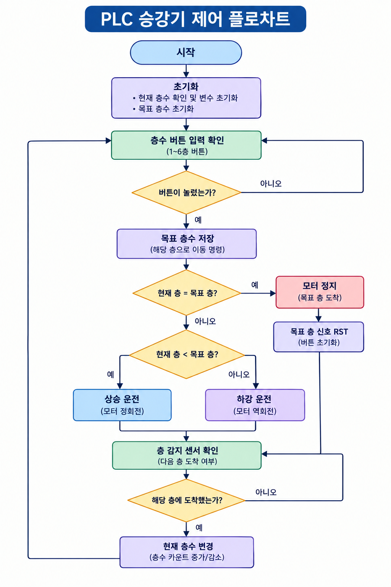

# 6-Floor Elevator

A working 6-floor elevator model. An AC motor with a speed controller moves the car, a pneumatic cylinder acts as the door, and a sensor on each floor detects a flag on the car. The floor buttons, direction arrows and door buttons inside the car are on a touchscreen HMI.

**▶ 3D simulator:** https://haquemdnazmul.github.io/elevator-simulator/ (built from the elevator's STEP assembly)

## Folders

| Folder | Contents |
|---|---|
| [`plc/`](plc/) | XG5000 ladder program |
| [`hmi/`](hmi/) | HMI screens (TOP Design Studio) |
| [`docs/`](docs/) | Control flowchart, PLC presentation, HMI user manual and parts list (in Korean) |

## Control logic

Read calls → find current floor → pick target floor → decide up or down → run motor → stop and open door.

The PLC program is split into six parts: switch input, floor sensing, direction, floor request, arrival and motor drive.

- Floor sensors are turned into a position value in `D00000`; the target floor goes in `D00001`.
- Comparing the two decides up (`D00000 < D00001`) or down (`D00000 > D00001`).
- On arrival the motor stops and timers handle the door.

## Requirements and test result

- 6 floors. Hall buttons: Up only at floor 1, Down only at floor 6.
- The HMI shows the current floor. Floors where the car will stop are red, the others blue.
- The car stops only for calls in its direction of travel and ignores floors it has passed.
- The door stays shut while the car moves. The emergency stop halts everything, and the car can run again after it is released.

Passed all 9 requirements and 9 of 10 functional tests. The speed controller is safe up to level 3 (limit 3.5). From level 4 the car's inertia carries it past the floor.
