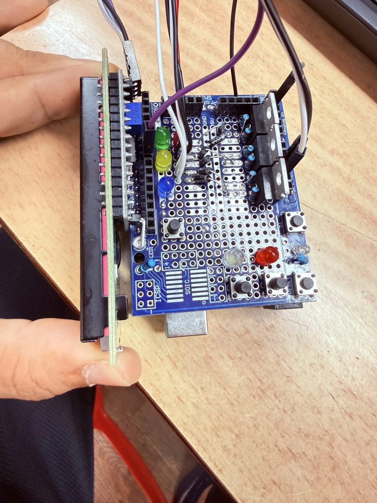
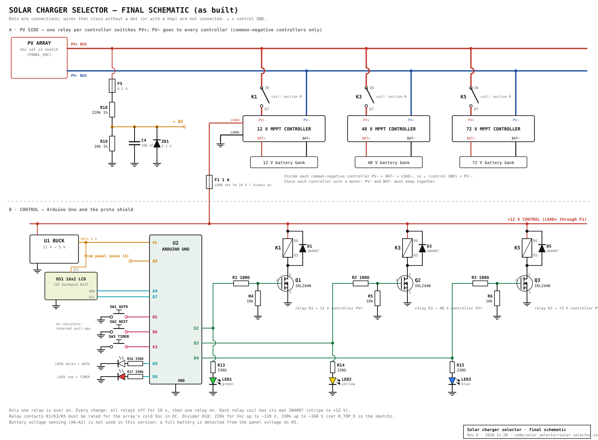

# Solar Charger Selector

One solar array, three battery banks (12 V, 48 V and 72 V). An Arduino Uno decides which bank's MPPT controller gets the panel. It switches the panel's PV+ with one relay per controller and works out from the panel voltage when a battery is full. No battery sense wires are needed.

**▶ Simulator:** https://haquemdnazmul.github.io/solar-simulator/final.html. It runs the same logic as the final firmware; speed up time to watch a whole day.
The [first-version simulator](https://haquemdnazmul.github.io/solar-simulator/) models the original relay-pair design and has faults you can switch on.

## Folders

| Folder | Contents |
|---|---|
| [`firmware/`](firmware/) | Arduino sketch (`solar_selector.ino`, final version) |
| [`drawings/`](drawings/) | `final_schematic.svg` (as built), `sheet6_panel_sense.svg` (panel sensing detail), the first-version sheets 1–4, the shield layout and the wiring guide |
| [`photos/`](photos/) | The built board and display |
| [`enclosure/`](enclosure/) | 3D-printable base and lid (STL) and the Python script that generates them |
| [`tools/`](tools/) | Python scripts that draw the schematics and the shield layout |

## How it works

- **Switching:** PV− goes to every controller (all are common-negative). PV+ is switched by one relay per controller (K1, K3, K5). Each relay is driven by an IRLZ44N logic-level MOSFET from D2, D3 or D4, with a flyback diode across the coil. The bank's charging LED is on the same pin.
- **Break-before-make:** only one relay is ever closed. Every change opens all of them and waits 10 s for the relays to drop out fully before closing exactly one.
- **Knowing when a battery is full:**
  - During each 10 s pause the Arduino reads the panel's open-circuit voltage (Voc) on A5, through a 220k/10k divider.
  - A charging controller pulls the panel down to about 80 % of Voc.
  - When its battery is full the controller stops taking current, and the panel climbs back above 95 % of Voc.
  - If that lasts 15 minutes, the battery counts as full.
  - Voc is re-read every 30 minutes, and a step that never reaches "full" ends after 4 hours.
- **Day and night:** if the panel stays dark for 10 minutes, all relays open. When the sun returns, the TIMER sequence starts again.
- **Display:** 16x2 LCD on an I2C backpack, driven by a small software I2C driver on A4/D7.
  - Line 1: the mode and the battery, or the 10 s countdown while switching.
  - Line 2 cycles through: the panel voltage and Voc, the time on the battery, and which batteries are full.

## Buttons and modes

| Button | Pin | Action |
|---|---|---|
| TIMER | A3 | 12 V for 3 hours, then 48 V until full, then 72 V until full, then AUTO. Starts by itself at power-up and every morning |
| AUTO | D5 | Charge each battery until full, then move to the next |
| NEXT | D6 | Short press: swap to the next battery in any mode. Hold 5 s: MANUAL mode (12 → 48 → 72 → OFF) |

Mode LEDs: white = AUTO (D9), red = TIMER (D8), both off = MANUAL.

The same commands also work over the serial monitor at 9600 baud:
- `auto`, `timer`, `timer N`
- `next`, `manual`
- `0` / `off` / `12` / `48` / `72`
- `?` for the status

Settings at the top of the sketch:
- `PV_SENSE`: `0` = time only, with no divider fitted.
- `PANEL_VOC`, `R_TOP_K`, `CAL_PV`: the panel sensing.
- `timer12Min`: the 12 V charging time.

## Build notes

The first drawings planned relay pairs and battery-voltage dividers on A0–A2. The board as built differs:

- **PV+ only:** the PV− terminals of all controllers are joined, and only PV+ is switched (3 relays instead of 6). This works only with common-negative controllers, where PV− and BAT− beep together on a meter.
- **Display SCL on D7:** the shield track from the display's SCL pin to A5 turned out to be broken, so the SCL wire goes to D7. The sketch drives the display with software I2C (`LCD_SOFT_SCL 7`), so no LCD library is needed.
- **Full detection from A5:** "full" comes from the panel voltage on A5. The A0–A2 battery dividers are not used.
- **Own layout:** the buttons and LEDs sit in different spots from the shield drawing.

## Status

Built on an Arduino Uno proto shield. Switching, buttons, LEDs and display are bench-tested, and the board fits the printed base.

Next steps:
- Fit the A5 panel divider, set `PANEL_VOC`, and calibrate against a multimeter.
- Cut the lid holes from the measured part positions (`enclosure/lid_parts.json`).
