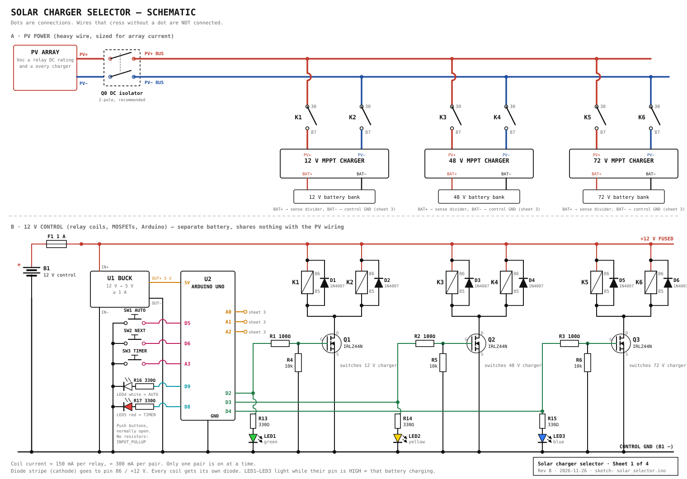

# Solar Charger Selector

One solar array, three battery banks (12 V, 48 V and 72 V). An Arduino Uno decides which bank's MPPT charger gets the panel. It switches the panel with three relay pairs and charges each battery in turn until it is full.

**▶ Simulator:** https://haquemdnazmul.github.io/solar-simulator/ (runs the same logic as the firmware, with faults you can switch on)

## Folders

| Folder | Contents |
|---|---|
| [`firmware/`](firmware/) | Arduino sketch (`solar_selector.ino`) |
| [`drawings/`](drawings/) | Schematic sheets 1–4, proto-shield top and bottom layout, wiring guide (`solar_selector_wiring.html`) |
| [`enclosure/`](enclosure/) | 3D-printable base and lid (STL) and the Python script that generates them |
| [`tools/`](tools/) | Python scripts that draw the schematic sheets and the shield layout |

## How it works

- **Switching:** each charger is connected by a relay pair (both + and − are switched). Each pair is driven by an IRLZ44N logic-level MOSFET from D2, D3 or D4, with a flyback diode across every coil. The charging LED for each bank hangs on the same pin.
- **Sensing:** A0–A2 read each bank through a resistor divider (33k, 150k and 220k over 10k).
- **Break-before-make:** only one relay pair may ever be closed. Every change opens all pairs and waits 10 s for the relays to fully drop out before closing exactly one.
- **Full detection:** a battery counts as full when it stays at or above its full voltage for a set hold time. It is then skipped until it falls below its resume voltage. When every battery is full, the last one stays connected so its charger can float it.
- **Display:** 16x2 LCD on an I2C backpack. Line 1 shows the mode and the bank being charged; line 2 steps through the three banks every 2 s (voltage, CHG / FULL / FLOAT / WAIT / LOW).

## Buttons and modes

| Button | Pin | Action |
|---|---|---|
| AUTO | D5 | Charge each battery until full, then move to the next |
| NEXT | D6 | Short press: swap to the next battery in any mode. Hold 5 s: MANUAL mode |
| TIMER | A3 | 12 V for 3 hours, then 48 V until full, then 72 V until full, then AUTO. Starts by itself at power-up |

Mode LEDs: white = AUTO (D9), red = TIMER (D8), both off = MANUAL. The same commands also work over the serial monitor at 9600 baud (`auto`, `timer`, `next`, `manual`, `0`/`off`/`12`/`48`/`72`, `?`).

## Build notes

The drawings show the planned layout. On the board as built:

- The display's SCL wire goes to **D7** and the sketch drives it with software I2C (`LCD_SOFT_SCL 7`), so no LCD library is needed.
- The buttons and LEDs sit in different spots from the shield drawing.

## Status

Built on an Arduino Uno proto shield, bench-tested and fitted in the printed base. Next steps: finish the ground return of the voltage-sense dividers and calibrate the readings, then cut the lid holes from measured part positions (`enclosure/lid_parts.json`).
