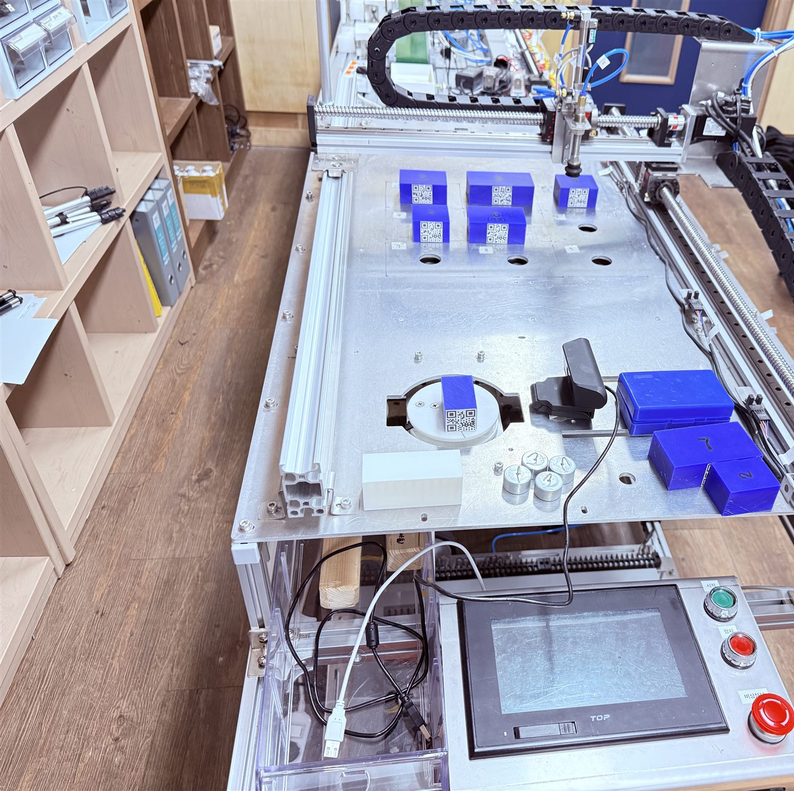

# Weight Sorting Cell

An automated cell that picks blocks, weighs each one on a load cell and places it into one of nine positions in weight order.



## How it works

1. An **Intel RealSense D455** depth camera finds the blue blocks on the table and measures each block's position, size and rotation.
2. A **WLKATA Mirobot** 6-axis arm picks the block with a suction cup and places it on the **load cell**.
3. The **LS XGB PLC** (XBM-DN32H2) reads the weight into `D00400`. The Python program reads that value over RS-485 and waits for it before the next pick.
4. A **2-axis servo gantry** with a pneumatic gripper, controlled by the PLC, moves the block into its slot. A 9-slot weight table keeps the slots in weight order.
5. The **HMI** and **CIMON SCADA** connect to the PLC over Ethernet (XGT FEnet).

## Folders

| Folder | Contents |
|---|---|
| [`plc/`](plc/) | XG5000 ladder program, a cleaned text listing of the whole program, the I/O device list and the variable list |
| [`vision-robot/`](vision-robot/) | Python camera + robot + PLC program (`d455_pick_place.py`), the XGT Cnet client (`plc_cnet.py`), tools, early prototypes and the user manual (EN/KR) |
| [`scada/`](scada/) | CIMON SCADA build guide, the tag generator (182 tags with alarms for two PLCs) and a browser-based SCADA mock-up |

The 3D simulator of this machine runs in the browser on the [portfolio site](https://haquemdnazmul.github.io/simulator/).

## Highlights

- **Automatic camera-to-robot calibration:** the arm visits 36 points at three heights while the camera tracks a marker on the tool, and OpenCV `solvePnPRansac` computes the camera's pose.
- **Weight as feedback:** if no weight appears after a place, the next pick goes 3 mm lower.
- **Own PLC protocol client:** `plc_cnet.py` speaks LS's XGT Cnet protocol over RS-485 (9600 8N1), with no vendor library.
- **Robust serial ports:** COM ports are found by USB VID:PID, and the link reopens itself if the adapter drops out.
- **Robot control:** the Mirobot is driven with raw G-code over USB serial.

## Running the Python code

```
py -3.12 -m pip install -r vision-robot/requirements.txt
py -3.12 vision-robot/d455_pick_place.py
```

Needs the D455 camera, the Mirobot and the USB-RS485 adapter connected. See `vision-robot/README.md` for details.
